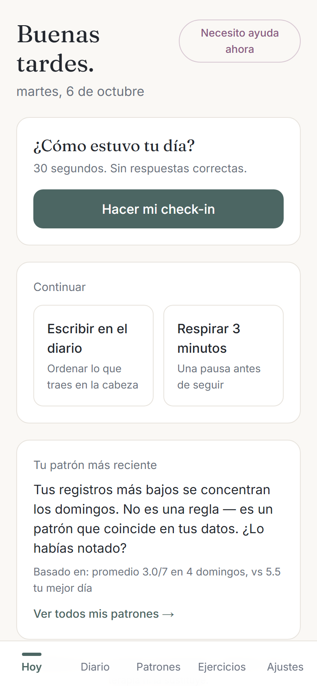
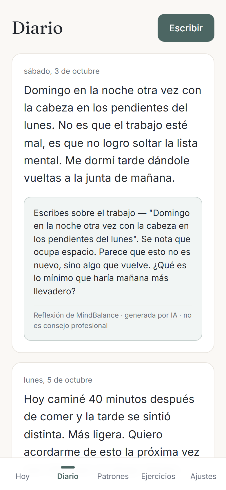
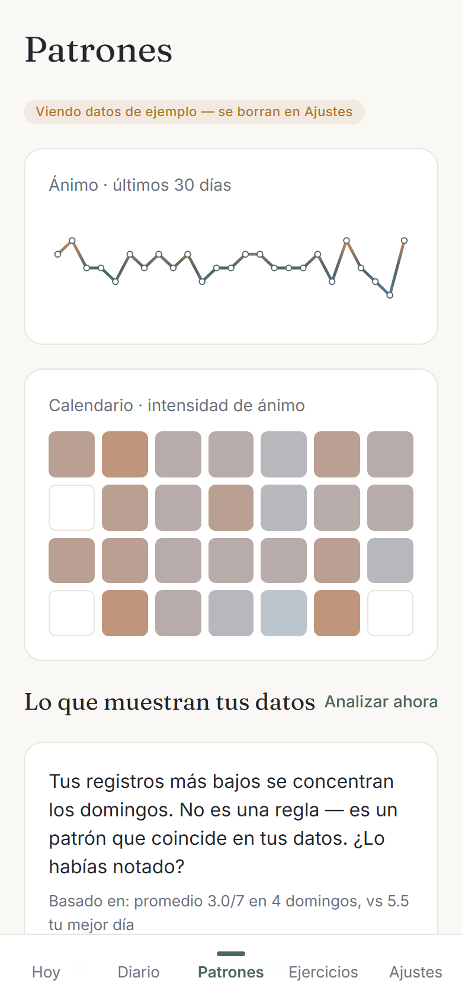
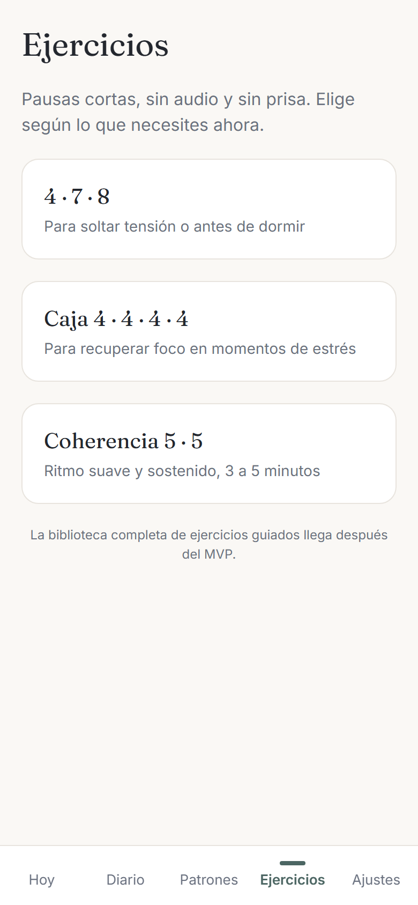

# MindBalance

App de **bienestar emocional con IA**: check-in diario de 30 segundos, diario con reflexión guiada, detección de patrones y ejercicios de respiración, con un protocolo de crisis integrado.

> MindBalance **no es terapia, no diagnostica y no trata**. Es reflexión guiada y registro personal.

**Demo en vivo (datos de ejemplo, funciona en el navegador):** https://angelmda2705.github.io/mindbalance-ai-demo/

## Capturas

## Estado

| Parte | Estado |
|---|---|
| Aplicación completa (web + API) | Desplegada y verificada de extremo a extremo; en fase de pruebas, sin tráfico público |
| Esta demo | Solo navegador, con datos de ejemplo |
| Pendiente antes de abrirla al público | Rotación de llaves, dominio propio y evaluación de seguridad ampliada |

La demo guarda todo en el dispositivo, sin cuenta y sin servidor. Las reflexiones del diario son **simuladas**; la IA real solo funciona en la versión conectada al servidor. Para ver la app con contenido, en "Patrones" usa "Cargar datos de ejemplo".

## Qué hace

- **Check-in diario** de ánimo, energía y contexto, en menos de 30 segundos.
- **Diario con reflexión:** devuelve una observación y una pregunta, nunca consejos clínicos, y marca toda respuesta como generada por IA.
- **Patrones:** línea de ánimo de 30 días, calendario de intensidad y observaciones basadas en los propios registros ("basado en: …"), sin presentarlas como reglas.
- **Ejercicios** de respiración (4·7·8, caja, coherencia).
- **Botón "Necesito ayuda ahora"** siempre visible, con recursos de crisis.
- **Privacidad por diseño:** funciona sin cuenta, el usuario decide si la IA procesa sus textos y puede exportar o borrar todo.

## Cómo está construida la versión completa

- **Frontend:** Next.js 16, React 19, TypeScript y Tailwind CSS 4, como PWA con exportación estática.
- **Backend:** Cloudflare Workers con base de datos D1; la web y la API comparten origen para que las cookies de sesión funcionen también en Safari.
- **Cuentas:** sesiones del lado del servidor, contraseñas con PBKDF2-SHA256 y limitación de intentos.
- **Cifrado por campo:** diario, notas y reflexiones se guardan cifrados con AES-256-GCM y una clave derivada por usuario.
- **Aislamiento por usuario:** cada consulta se filtra por un identificador pseudónimo.
- **Canal de IA con seguridad primero:** limpia el texto, **clasifica el riesgo antes de generar nada**, responde con una plantilla de crisis sin usar IA generativa cuando el riesgo es alto, y filtra la salida.
- **Derechos del usuario:** exportación completa en JSON y borrado inmediato de la cuenta.
- **Evaluación:** corpus de casos de seguridad para medir falsos negativos en situaciones de riesgo.

El código fuente completo es privado y puede revisarse en una sesión técnica, bajo solicitud.

## Licencia

Copyright (c) 2026 Ángel Mendiola. Todos los derechos reservados. Ver [`LICENSE`](LICENSE).
